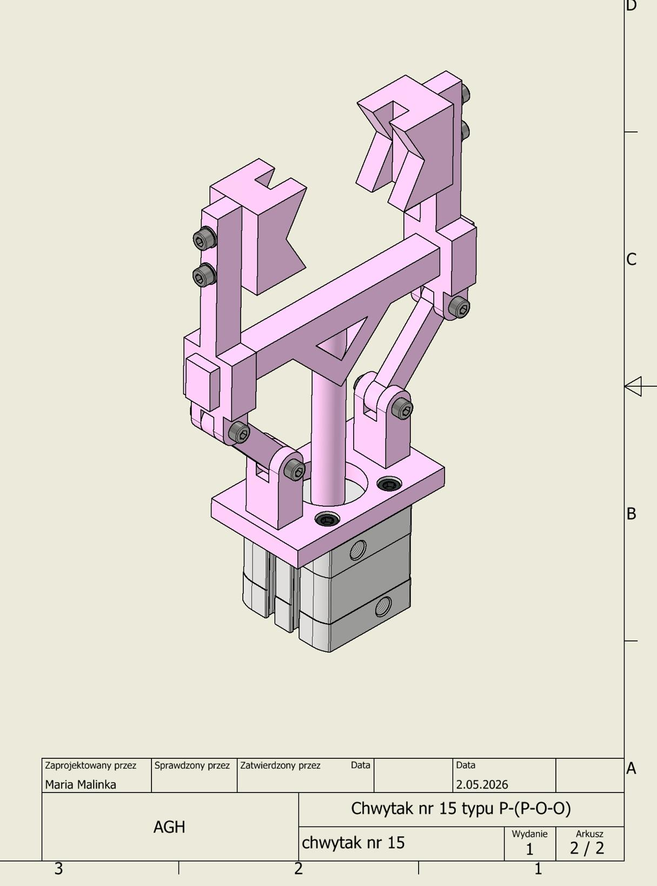
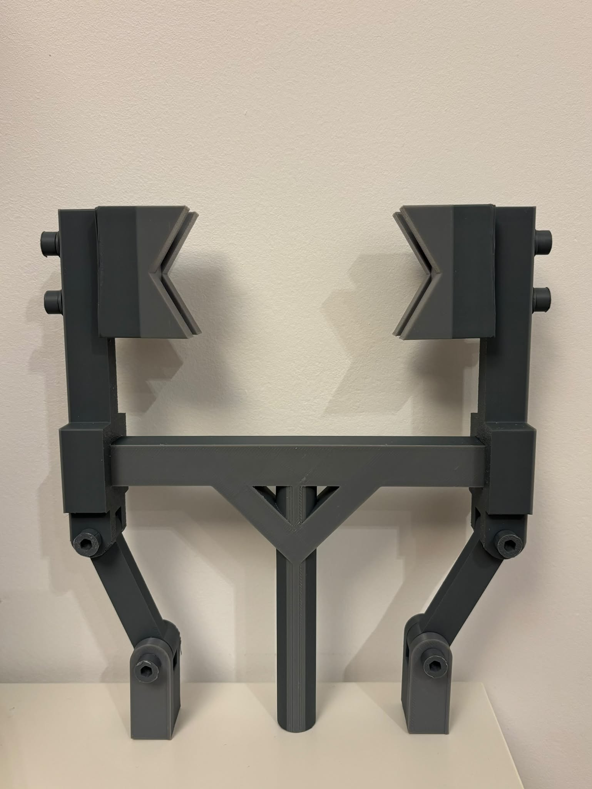

# Pneumatic Gripper for an Industrial Manipulator – No. 15, type P-(P-O-O)

A university design project from the **Automatic Control and Robotics** programme at **AGH University of Krakow** (Faculty of Electrical Engineering, Automatics, Computer Science and Biomedical Engineering), by **Maria Malinka**, 2026.

The project covers the full design of a two-jaw pneumatic gripper for an industrial robot arm: from the kinematic scheme and mechanism analysis, through force and strength calculations, to choosing a real pneumatic cylinder, building a CAD model and **3D printing a physical prototype**.

*CAD assembly of the gripper, designed in Autodesk Inventor Professional 2026.*

## The 3D-printed prototype

The gripper was **3D printed** to build a physical model of the design (FDM, Bambu Lab X1C, ASA, 0.2 mm layers, about 3 h 48 min and 83.6 g of filament; see section 13 of the report). The photo shows the printed arms, V-shaped jaws, crossbar slide guide, pivot links and central piston rod, assembled with metal hex socket screws at the joints.

*The 3D-printed gripper prototype.*

## What the gripper does

The gripper picks up a steel shaft at its starting position, holds it securely while the manipulator moves it, and releases it at the target location.

| Requirement | Value |
|---|---|
| Object | Steel shaft, Ø 62–78 mm, length 100 mm |
| Max. object weight | ≈ 37.3 N |
| Supply | Compressed air, 0.6 MPa nominal |
| Required gripping force | 220 N (incl. overload factor 2, steel–steel friction μ = 0.15) |
| Jaw shape | V-jaws, 120° opening angle, 25 mm jaw faces |

## How it works

- **Mechanism:** one linear pneumatic cylinder pushes a central slider (link 1). Two pivot links (2, 2′) anchored to the base swing the gripper arms (3, 3′), which close the V-jaws symmetrically around the shaft.
- **Mobility:** W = 3·5 − 0 − 2·7 = **1**, so a single actuator drives both jaws.
- **Actuator:** **Festo ADN-S-40-10-A-P-A** compact double-acting cylinder, Ø 40 mm, 10 mm stroke, up to 754 N at 0.6 MPa, mounted with a Festo FNC-40 flange.
- **Overall size:** about 248 × 150 × 54 mm.

## What the report covers

1. Design task and requirements
2. Mobility (degrees of freedom) of the mechanism
3. Object weight, required gripping force and jaw dimensions
4. Displacement characteristic y(x) – jaw position vs. piston extension
5. Velocity characteristic f_v(x)
6. Force characteristic f_F(x) – gripping force / actuator force
7. Verification with the instantaneous power method
8. Maximum required actuator force: **558.9 N**
9. Strength checks – pin shear (Ø 4 mm pins) and arm bending (35.2 MPa vs. 140 MPa allowed)
10. Minimum piston diameter: **37.7 mm**
11. Cylinder selection from the Festo catalogue
12. Assembly drawing and parts list
13. 3D-printed prototype

## Files

| File | Description |
|---|---|
| `chwytak_mariamalinka.pdf` | Original report in Polish |
| `gripper_report_EN.pdf` | The same English report as a PDF |
| `images/` | Figures from the report and the photo of the 3D-printed prototype |

## Tools

- Autodesk Inventor Professional 2026 – CAD model and assembly drawings
- Bambu Studio + Bambu Lab X1C (ASA) – 3D-printed prototype
